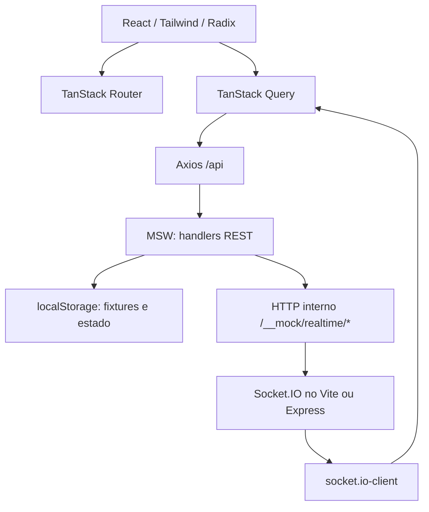
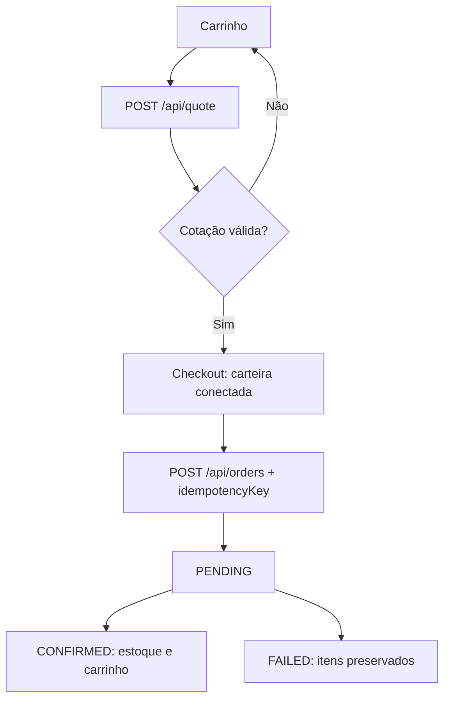

# Arquitetura — Kurio Marketplace

Este documento descreve a arquitetura **implementada no projeto**, seu fluxo de dados, as escolhas técnicas e os limites conhecidos. O sistema é uma demonstração frontend com APIs e pagamentos simulados; não deve ser interpretado como uma plataforma blockchain de produção.

## 1. Visão geral



O desenho separa interface, orquestração assíncrona, transporte HTTP, simulação e eventos em tempo real. O processo de Node serve arquivos estáticos e Socket.IO; os endpoints `/api` da demonstração são interceptados no navegador pelo MSW.

## 2. Responsabilidades por camada

| Camada | Local | Responsabilidade |
| --- | --- | --- |
| Bootstrap | `src/main.tsx` | Iniciar MSW, QueryClient, Router e React |
| Rotas | `src/router.tsx` | Páginas, parâmetros de rota, busca validada e 404 |
| Telas | `src/pages/` | Renderização, interação e feedback |
| Componentes | `src/components/` | Layout, galerias, UI reutilizável e footer |
| API | `src/api/` | Cliente Axios, tipos e operações HTTP |
| Simulação | `src/mocks/` | Contratos HTTP, fixtures, estoque e persistência |
| Tempo real | `src/realtime/` | Cliente WebSocket, listeners, versões e invalidação |
| Servidor local | `vite.config.ts` | Socket.IO e ponte de eventos no dev/preview |
| Servidor Node | `server.mjs` | Servir `dist`, SPA fallback e Socket.IO no deploy |
| Testes | `tests/` | Playwright funcional/visual e integrações reais |

### Inicialização e configuração

O arquivo `main.tsx` aguarda o `worker.start()` quando `VITE_ENABLE_MOCKS !== "false"`. Depois monta `QueryClientProvider` e `RouterProvider`. O `QueryClient` usa `staleTime: 30000`, `retry: 1` e `refetchOnWindowFocus: false` como opções gerais; consultas específicas podem substituir essas políticas.

O Axios é instanciado com `baseURL: "/api"` e `timeout: 10000`. Um interceptor de requisição recupera `kurio:auth-token` do `localStorage` e envia `Authorization: Bearer ...` quando há sessão.

**Consequência:** desativar o MSW por configuração requer uma API compatível não fornecida neste repositório. O serviço Express não implementa os recursos de negócio `/api`.

## 3. Rotas e navegação

- Home (`/`): estado de `search`, `category`, `sort` e `page` validado pelo TanStack Router; alterações de filtro reiniciam a página.
- Detalhes (`/nft/$nftId`): consulta por ID; galeria, informações, seleção de edição e compra.
- Carrinho (`/carrinho`): itens do visitante ou do usuário, quantidades e cotação.
- Login/cadastro (`/login`, `/cadastro`), perfil (`/perfil`) e carteiras (`/carteiras`).
- Checkout (`/checkout?quoteId=...`): recupera a cotação por ID e compara a carteira escolhida com a rede da cotação.
- Pedido (`/pedido/$orderId`): consulta persistida e assinatura de eventos do pedido.

O componente raiz compartilha `Header` e `Footer` e oferece uma página de recurso não encontrado. A autorização efetiva das operações sensíveis é verificada nos handlers MSW. A proteção visual e o retorno contextual de todas as rotas privadas ainda merecem auditoria final.

## 4. Contratos REST e modelagem

Os contratos de transporte e os tipos TypeScript estão em `src/api/`. O MSW expõe os endpoints equivalentes em `src/mocks/`.

| Domínio | Endpoints principais | Modelo |
| --- | --- | --- |
| NFT | `GET /api/nfts`, `GET /api/nfts/:id` | `NFT`, `NFTEdition`, `NFTListResponse` |
| Conta | `POST /api/auth/login`, `POST /api/auth/register`, `GET /api/auth/session`, `POST /api/auth/logout` | Usuário e sessão |
| Perfil | `GET/PATCH /api/profile`, `PATCH /api/profile/password` | Dados/avatar/senha |
| Favoritos | `GET /api/favorites`, `POST/DELETE /api/favorites/:nftId` | Lista de IDs |
| Carrinho | `GET /api/cart`, `POST /api/cart/items`, `PATCH/DELETE /api/cart/items/:nftId`, `POST /api/cart/merge` | Item por NFT e edição |
| Cotação | `POST /api/quote`, `GET /api/quote/:quoteId` | `QuoteResponse` |
| Pedido | `POST /api/orders`, `GET /api/orders/:orderId` | `Order`, status |
| Carteiras | `GET/POST /api/wallets`, `PATCH /api/wallets/:walletId`, `POST /api/wallets/:walletId/connection` | Carteira e conexão |

O catálogo limita a três NFTs por página no mock. Os parâmetros de busca, categoria e ordenação são enviados à API; o resultado contém itens, quantidade total, página e total de páginas. NFTs inexistentes retornam `404`.

### Valores ETH

No contrato, os valores monetários são strings (`"0.85"`, `"1.10"`, etc.), nunca floats JSON usados para cálculos finais. No mock de cotação, valores são convertidos para wei por `bigint` (18 casas), aplicando desconto e taxa como inteiros, e só então convertidos para strings de ETH.

As redes de demonstração são `ethereum` e `polygon`. O cupom `KURIO10` corresponde a desconto de 10%; `OLD10` simula expiração. As taxas do mock são fixas por rede e **não representam gas real**.

### Edições e estoque

`NFT.editions` é opcional para compatibilidade com fixtures legadas. Cada edição possui `id`, `type`, `available` e `priceEth`; existem tipos `1/1`, `1/10`, `1/50` e `OPEN`. O item de carrinho preserva `editionId` quando necessário; a edição padrão mantém compatibilidade com o formato legado.

O estoque é consultado por NFT/edição. A confirmação do pedido desconta unidades por `commitOrderStock`, com proteção contra reaplicação do mesmo pedido; a recusa não altera estoque ou carrinho.

## 5. Sessão, isolamento e persistência

O estado dos mocks é armazenado em chaves de `localStorage` do domínio atual. O visitante possui carrinho independente; o usuário autenticado possui carrinho e dados privados associados à sua identidade. A operação `/api/cart/merge` transfere itens visitantes ao entrar ou criar uma conta.

As contas demonstrativas iniciais são Ana (`ana@kurio.test`) e Pedro (`pedro@kurio.test`), ambos com a senha fictícia `Demo1234!`. Senhas armazenadas pelo mock usam salt e hash SHA-256; sessões demonstrativas possuem tokens e expiração. Esta estratégia é **apenas educacional**: autenticação, autorização e armazenamento de tokens/senhas de produção devem ficar em backend seguro.

Testes cobrem transferência de carrinho, isolamento entre usuários, sessão inválida, perfil, senha, carteira e favoritos. Recomenda-se continuar revisando a invalidação de cache e subscriptions ao encerrar/trocar sessões.

## 6. Fluxo de cotação e pedido



1. O carrinho fornece NFTs/edições, quantidades e rede. A API de cotação verifica disponibilidade, cupom e taxas; a cotação expira em cinco minutos.
2. O checkout recupera a cotação por `quoteId`; a carteira selecionada precisa pertencer à rede e estar conectada.
3. O cliente cria uma `idempotencyKey` e a armazena em `sessionStorage` vinculada à tentativa de cotação.
4. O mock retorna um pedido `PENDING` e mantém o snapshot dos itens e valores negociados.
5. Consultas posteriores ao pedido processam o resultado simulado no tempo definido pelas fixtures: `CONFIRMED` ou `FAILED`.
6. Em `CONFIRMED`, o estoque é comprometido uma vez e o carrinho é reconciliado; `FAILED` mantém o carrinho. Os estados finais não são reprocessados.
7. A tela do pedido consulta periodicamente enquanto `PENDING` e recebe eventos `order.updated`, recuperando o estado por REST.

Pedidos repetidos com a mesma chave de idempotência retornam o pedido existente quando a intenção é idêntica; a chave usada com dados incompatíveis retorna conflito. O simulador não realiza pagamentos, assinaturas de transação ou comunicação com blockchain.

## 7. Tempo real e consistência

### Transporte

Socket.IO utiliza WebSocket no caminho `/socket.io`, em mesma origem. Há duas variantes de servidor com o mesmo protocolo:

- `vite.config.ts`: plugin Socket.IO no desenvolvimento e preview.
- `server.mjs`: HTTP/Express + Socket.IO na execução Node.

Handlers do MSW propagam mudanças por HTTP interno (`POST /__mock/realtime/nft` e `POST /__mock/realtime/order`), e o servidor retransmite eventos Socket.IO. Portanto, os testes exercitam o **cliente Socket.IO real**, embora o transporte dos mocks não utilize `@mswjs/socket.io-binding`.

### Eventos

| Evento | Payload | Consumidor |
| --- | --- | --- |
| `nft.updated` | `{ nftId, version }` | Catálogo, detalhe, carrinho/cotação |
| `order.updated` | `{ orderId, version }` | Página do pedido inscrito |
| `realtime.ready` | `{ connected, version }` | Sinal inicial do servidor |
| `order.watch` / `order.unwatch` | ID do pedido | Inscrição/cancelamento de sala |

O cliente ignora versões não finitas, antigas e duplicadas em cada listener. Mudanças desencadeiam invalidação de consultas TanStack Query; **REST é a fonte da verdade**, e o evento apenas avisa que pode haver um recurso atualizado. Ao conectar/reconectar, os recursos ativos são consultados novamente.

### Limitações importantes

- As salas de pedido baseadas em `orderId` não constituem autorização de produção por usuário.
- Os listeners compartilham uma instância de cliente Socket.IO; o ciclo de conexão/desconexão entre componentes requer cuidado.
- Ainda é necessário demonstrar em testes dedicados duplicatas, eventos fora de ordem, isolamento entre sessões e interrupção/reconexão durante checkout ou pagamento pendente.
- A integração da simulação de Socket.IO com MSW é uma ponte interna; se o avaliador exigir especificamente um binding de socket ao MSW, será necessária adaptação técnica.

## 8. Cenários de rede e recuperação

O arquivo `src/mocks/scenarios.ts` define cenários configuráveis por `localStorage`, com `{ delayMs, failure }`. As falhas disponíveis são `none`, `http500` e `network`, aplicadas às rotas de leitura do catálogo e detalhe. O valor de atraso é limitado a 30 segundos.

Os testes `tests/network-failures.spec.ts` cobrem skeleton, HTTP 500 e falha de rede com nova tentativa. Há validações específicas nas APIs simuladas para sessão, estoque, cupom, carteira e pedido.

**Lacunas conhecidas:** cenário centralizado de latência variável, respostas fora de ordem, timeout depois da criação persistida do pedido e revalidação/reconfirmação explícita sob mudança de preço/disponibilidade. Não se deve marcar esses cenários como concluídos sem testes observáveis.

## 9. Estratégia de testes e qualidade

- `playwright.config.ts`: Chromium, desktop 1440 × 900 e mobile 390 × 844, porta 4173 com preview de produção.
- Fluxos E2E: `marketplace`, `auth-cart`, `favorites`, `wallets`, `profile`, `quote`, `orders`, `editions`, `network-failures`, `realtime`, `accessibility` e `tablet`.
- Testes de regressão visual: Home, detalhe, carrinho, checkout e confirmação, com capturas versionadas para Windows (desktop/mobile).
- Tablet: `tests/tablet.spec.ts` executa a largura 768 px dentro do projeto desktop; cobre ausência de overflow nas telas principais, sem substituir auditoria visual manual.
- As fixtures e o `localStorage` são isolados por contexto de navegador. Cenários de tempo são acompanhados com polling de estado no REST.
- Auditoria Lighthouse CI: Home e detalhe do NFT, três execuções por perfil. Metas e medianas em `docs/PERFORMANCE.md`; HTML/JSON finais em `reports/lighthouse/final/`.

Comandos principais:

```bash
npm ci
npm run lint
npm run build
npx playwright test
npx playwright show-report
```

Com preview ativo:

```bash
npx lhci collect
npx lhci collect --collect.settings.preset=desktop
```

Para preservar resultados de cada perfil separadamente, exporte com `npx lhci upload --target=filesystem --outputDir=<diretorio>` após cada coleta. A coleta seguinte substitui os artefatos temporários em `.lighthouseci/`.

## 10. Segurança e limites do protótipo

- O MSW e `localStorage` executam no dispositivo do visitante: os dados podem ser editados por quem usa o navegador.
- Tokens de demonstração são mantidos no navegador; não são cookies seguros de servidor.
- As credenciais são fictícias e não devem ser utilizadas fora deste ambiente.
- O servidor Socket.IO não valida a identidade de cada observador da sala como faria um backend real.
- Cotações, taxas, redes, status e referências financeiras não têm efeito na blockchain.
- Não há persistência compartilhada, garantia de durabilidade ou antifraude de produção.

## 11. Evolução priorizada antes da entrega

1. Comparar as telas e campos do checkout/recibo com o Figma; completar dados do colecionador e referência de transação simulada, se aplicáveis ao frame obrigatório.
2. Criar cenários MSW determinísticos de timeout depois do `POST /orders`, respostas fora de ordem e alterações de preço/estoque no checkout com reconfirmação.
3. Ampliar E2E dos fluxos em tempo real (duplicatas, versões obsoletas, reconexão, troca de sessão) e foco visual em diálogos.
4. Finalizar auditoria manual a 768 px e verificar o contraste/foco contra os frames fornecidos.
5. Rodar suíte completa, conferir relatórios, revisar a versão publicada e documentar o hash final do commit entregue.

Estas pendências são registradas explicitamente para distinguir **código já entregue**, **comportamento exercitado por testes** e **requisitos ainda em validação**.
